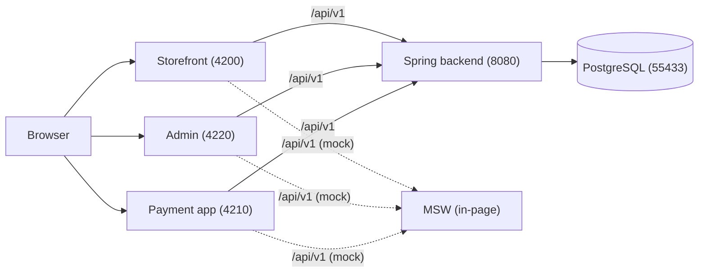

# MiBolt

MiBolt is a demo webshop: an Angular storefront, a demo payment app and an
admin app in front of a Spring Boot backend, PostgreSQL and a shared OpenAPI
contract. This file is the install, start and workflow guide; see
[`frontend/README.md`](frontend/README.md) for the Angular workspace,
[`backend/README.md`](backend/README.md) for the backend, and
[`docs/monorepo.md`](docs/monorepo.md) for the folder map.

## 🔧 Install after git clone

Prerequisites:

- [mise](https://mise.jdx.dev), at least `2026.7.11` (`mise.toml`'s
  `min_version`).
- Nothing else to install by hand: `mise install` reads the versions pinned
  under `[tools]` and installs them. The root `mise.toml` pins Node
  `26.10.0` and Java `temurin-21.0.12+101.0.LTS`; `contracts/mise.toml` pins
  the contract tools.
- Docker, for PostgreSQL (every mode below that touches the backend starts
  it in a container) and for the backend and web images used by
  `backend:docker`, `dev:docker` and `stack`.

Commands, in order:

```bash
git clone git@github.com:mimukodik/mi-bolt.git
cd mi-bolt
```

The workspace has five `mise.toml` files (the root one plus
`frontend/mise.toml`, `backend/mise.toml`, `tools/mise.toml` and
`contracts/mise.toml`, wired together by the root file's `[monorepo]`
table). mise refuses to parse a config file it does not yet trust, so if it
asks, trust the whole tree once from the repository root:

```bash
mise trust --all
```

```bash
mise install
```

Installs the Node and Java versions pinned in the root `mise.toml`, plus the
contract tools (`uv`, `vacuum`, `check-jsonschema`, `plantuml`) pinned in
`contracts/mise.toml`.

```bash
mise run setup
```

Installs every workspace's dependencies: the frontend's npm packages
(`frontend/mise.toml`'s `setup`, `npm ci`), the backend's Gradle wrapper
(`backend/mise.toml`'s `setup`, `./gradlew --version`), the tools
workspace's npm packages (`tools/mise.toml`'s `setup`, `npm ci`), and the
Claude Code hooks' own npm packages (the root `mise.toml`'s `setup` task,
`npm --prefix .claude/hooks ci`).

```bash
npm --prefix frontend run e2e:install
```

Installs the Playwright browsers (Chromium, Firefox, WebKit) with their OS
dependencies (`frontend/package.json`'s `e2e:install` script).

## 👤 Start the apps: which mode when

When the backend only has to run because the frontend needs it, pick
`dev:docker` (or `backend:docker` for the backend alone) over the native
`backend`/`dev`, which you then have to babysit as a foreground Gradle
process.

### `storefront`

Pick this when you are working on the shop UI alone and the in-page MSW
mock is enough.

```bash
mise run storefront
```

Runs on port 4200 with the MSW mock. Stop with Ctrl+C.

### `admin`

Pick this when you are working on the admin app alone and the in-page MSW
mock is enough.

```bash
mise run admin
```

Runs on port 4220 with the MSW mock. Stop with Ctrl+C.

### `payment`

Pick this when you are working on the demo payment page alone.

```bash
mise run payment
```

Runs on port 4210 on the app's own in-page MSW mock: `npm run start:payment`
serves the `development` configuration, and
`frontend/projects/demo-payment/src/main.ts` starts the mock whenever
`isDevMode()` is true. Stop with Ctrl+C.

### `frontend`

Pick this when a change touches more than one app, or you need to click
through the shop → payment → back-to-shop flow, still on the mock.

```bash
mise run frontend
```

Starts all three apps together with the MSW mock: storefront 4200, payment
4210, admin 4220. Stop with Ctrl+C.

### `db`

Pick this when you only need PostgreSQL, for example to point a backend you
are running from an IDE at it.

```bash
mise run db
```

Starts PostgreSQL alone on port 55433, in its container, and waits until it
is healthy. Stop with `mise run stop`.

### `backend`

Pick this when you are working on the backend and want the native Gradle
`bootRun` loop.

```bash
mise run backend
```

Starts PostgreSQL in its container (port 55433), then the backend natively
on port 8080 against the real database — no MSW involved, since no frontend
app is running. Stop the backend with Ctrl+C, then `mise run stop` for the
database container.

### `backend:docker`

Pick this when the backend only has to run because something else (the
frontend, a manual API check) needs it, and you would rather not babysit a
native Gradle process.

```bash
mise run backend:docker
```

Builds and starts the `mi-bolt-commerce` image on port 8080, PostgreSQL in
its container on port 55433. Stop with `mise run stop`.

### `dev`

Pick this when frontend work needs the real backend's data and behaviour,
and running Gradle natively alongside it is fine.

```bash
mise run dev
```

Starts PostgreSQL and the native backend (port 8080), then the storefront
and admin on their `local-backend` configuration (real backend, MSW off:
`environment.local-backend.ts` replaces `environment.ts`) on ports 4200 and
4220, plus the payment app on 4210 in its `local-backend` configuration (the
`production` build, so its MSW mock never starts; `/api` goes to port 8080).
Stop the frontend and backend processes with Ctrl+C, then `mise run stop` for
the database container.

### `dev:docker`

Pick this when the backend only has to run because the frontend needs it —
the recommended default for full-stack frontend work.

```bash
mise run dev:docker
```

Same as `dev`, but the backend runs in its container instead of natively, so
there is no Gradle process to babysit. Stop the frontend processes with
Ctrl+C, then `mise run stop` for the containers.

### `stack`

Pick this when you want the whole system exactly as it deploys: one static
web container instead of three separate `ng serve` processes. This is also
the mode for a full purchase against the real backend, payment included.

```bash
mise run stack
```

Builds and starts every container: web on port 4200 (the storefront at `/`,
the admin at `/admin/` and the payment app at `/demo-fizetes/`, all from the
same origin — see "The stack" below), backend on 8080, PostgreSQL on 55433.
Stop with `mise run stop`.

### `stop`

Pick this whenever you are done with any container-based mode above.

```bash
mise run stop
```

Stops every container of the stack. The database volume keeps its data.

## 🔧 Ports

| Port  | What                                              |
| ----- | ------------------------------------------------- |
| 4200  | Storefront                                        |
| 4210  | Demo payment app                                  |
| 4220  | Admin app                                         |
| 8080  | Spring backend                                    |
| 55433 | PostgreSQL                                        |
| 4400  | Playwright's `seed`/`integration` web server      |
| 4410  | Playwright's `smoke` (`local-backend`) web server |

`deploy/compose.yaml` reads three environment variables to move the
container ports for a second stack running beside the default one:
`MIBOLT_POSTGRES_PORT` (default 55433), `MIBOLT_BACKEND_PORT` (default 8080) and `MIBOLT_WEB_PORT` (default 4200, `stack` mode only).

## 📋 The stack



Solid arrows are the `local-backend` configuration (`dev`, `dev:docker`),
dashed ones the MSW mock. The payment app follows the same split: `dev` and
`dev:docker` serve it on the backend, `payment` and `frontend` on its mock.

The `stack` mode collapses the three apps into the one `web` container
(`frontend/Dockerfile` copies the storefront to `/`, the admin to `/admin/`
and the payment app to `/demo-fizetes/`), so the backend's payment redirect
and return point at the web origin instead of the dev servers' 4210 and 4200
(`mise.toml`'s comment on the `stack` task, `deploy/compose.yaml`'s `web`
service).

## 👤 The order flow

```mermaid
flowchart LR
    list["List (/telefonok)"] --> product["Product (/telefonok/:slug)"]
    product --> cart["Cart (/penztar/kosar)"]
    cart --> contact["Contact (/penztar/adatok)"]
    contact --> delivery["Delivery (/penztar/szallitas)"]
    delivery --> review["Review (/penztar/ellenorzes)"]
    review --> paymentApp["Payment app (/demo-fizetes/:paymentIntentId)"]
    paymentApp --> back["Back to the shop (/penztar)"]
    back --> order["Order (/penztar/ellenorzes)"]
    order --> receipt["Receipt (/penztar/siker/:orderId)"]
```



"Review" and "Order" are the same route: the return leg lands on
`/penztar` and hydrates, then hands off to the review page, which both
shows the order for confirmation and, once the shopper submits it, places
it and navigates on to the receipt.

## 🎯 Workflows

1. **Frontend-only work on the mock**

   ```bash
   mise run frontend   # or mise run storefront / mise run admin / mise run payment alone
   ```

   Edit under `frontend/`; every app stays on the MSW mock, so nothing else
   needs to run.

2. **A full-stack change with the backend in Docker**

   ```bash
   mise run dev:docker
   ```

   Edit under `frontend/` and/or `backend/`; `mise run stop` when done.

3. **Changing the API contract**

   Edit `contracts/commerce/openapi.yaml`, then:

   ```bash
   mise run api:generate
   mise run api:drift
   mise run contracts:check
   ```

4. **Before opening a pull request**

   ```bash
   mise run verify
   ```

5. **What CI runs**

   `.github/workflows/ci.yml`'s `changes` job reads
   `.github/components.yml`'s path filters and runs each matching
   component's reusable workflow (`frontend.yml`, `backend.yml`,
   `contracts.yml`, `tools.yml`). The aggregate `ci-ok` check passes once
   every needed branch has succeeded or was skipped.

## 🔧 Command reference

Every task below runs from the repository root as `mise run <task>`.

| Task                     | Description                                                                                    |
| ------------------------ | ---------------------------------------------------------------------------------------------- |
| `frontend`               | The three apps with ng serve and the MSW mock: storefront 4200, payment 4210, admin 4220       |
| `storefront`             | The storefront alone with the MSW mock, on 4200                                                |
| `admin`                  | The admin alone with the MSW mock, on 4220                                                     |
| `payment`                | The demo payment app alone, on 4210                                                            |
| `db`                     | PostgreSQL alone, in its container on 55433                                                    |
| `backend`                | The backend natively (Gradle bootRun) on 8080, PostgreSQL in its container                     |
| `backend:docker`         | The backend in its container (the mi-bolt-commerce image) on 8080, PostgreSQL in its container |
| `dev`                    | The three apps against the native backend, PostgreSQL in its container                         |
| `dev:docker`             | The three apps against the backend container, PostgreSQL in its container                      |
| `stack`                  | The whole system in containers: web on 4200, backend on 8080, PostgreSQL on 55433              |
| `stop`                   | Stop every container of the stack; the database volume keeps its data                          |
| `setup`                  | Install every workspace's dependencies                                                         |
| `verify`                 | Lint, test and build every workspace, and check the contract                                   |
| `api:generate`           | Regenerate the frontend API clients and the backend server stubs from the contract             |
| `api:drift`              | Fail when the committed frontend API clients differ from the contract                          |
| `contracts:check`        | Lint the contract, validate the samples, check the sequence diagrams                           |
| `claude:memory`          | The shared agent memory CLI; pass its arguments after the task name                            |
| `claude:hooks:test`      | Test the Claude Code hooks                                                                     |
| `claude:hooks:typecheck` | Typecheck the Claude Code hooks                                                                |

For the npm scripts behind the frontend tasks, see
[`frontend/README.md`](frontend/README.md); for the Gradle tasks behind the
backend ones, see [`backend/README.md`](backend/README.md).

## 📋 Further reading

- [`docs/monorepo.md`](docs/monorepo.md) — the folder map and the CI path
  filters.
- [`frontend/README.md`](frontend/README.md) — the Angular workspace.
- [`backend/README.md`](backend/README.md) — the backend.
- [`frontend/docs/README.md`](frontend/docs/README.md) — the frontend
  design and execution documentation.
- [`frontend/docs/api/README.md`](frontend/docs/api/README.md) — SDK
  generation and fixtures.
- [`frontend/docs/design/README.md`](frontend/docs/design/README.md) — the
  yettel design reference.
- [`contracts/commerce/openapi.yaml`](contracts/commerce/openapi.yaml) —
  the shared API contract.
