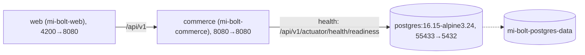
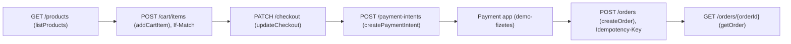

# MiBolt backend

The Spring Boot service under `services/commerce/`, built into the
`mi-bolt-commerce` image (`../deploy/compose.yaml`). Install and the
`mise run` start modes are in the root [`README.md`](../README.md).

## 👤 Run it: which mode when

The root README owns the full mode list; this is only what matters for the
backend alone.

- **The backend only has to run because the frontend needs it**:
  `mise run backend:docker` (or `mise run dev:docker` for the frontend too),
  since it needs no babysat Gradle process.
- **Changing backend code**: `mise run backend` (native `bootRun`, PostgreSQL
  in its container), or `mise run db` plus a run from the IDE.
- **The whole system as it deploys**: `mise run stack`.

Environment variables the service reads, with their defaults:

| Variable                             | Default                                                                                                     |
| ------------------------------------ | ----------------------------------------------------------------------------------------------------------- |
| `MIBOLT_DB_URL`                      | `jdbc:postgresql://localhost:55433/mi_bolt`                                                                 |
| `MIBOLT_DB_USER`                     | `mi_bolt`                                                                                                   |
| `MIBOLT_DB_PASSWORD`                 | `mi_bolt_local`                                                                                             |
| `MIBOLT_ADMIN_INITIAL_PASSWORD`      | empty (a generated password is printed once at WARN)                                                        |
| `MIBOLT_DEMO_USERNAME`               | `MiBoltDemoUser` (read only while the `demo_user` table is empty)                                           |
| `MIBOLT_DEMO_PASSWORD`               | `1MiBoltDemo1` (not a secret; read only while the `demo_user` table is empty)                               |
| `MIBOLT_PAYMENT_REDIRECT_URL_PREFIX` | `http://localhost:4210/demo-fizetes/`                                                                       |
| `MIBOLT_PAYMENT_RETURN_URL_PREFIX`   | `http://localhost:4200/penztar?paymentIntentId=`                                                            |
| `MIBOLT_CATALOG_PATH`                | `../../../data/catalog` (relative to `services/commerce/`; the Docker image sets it to `/app/data/catalog`) |
| `MIBOLT_SMOKE_ENABLED`               | `false` (Compose and the demo/preview chart enable it explicitly)                                         |
| `MIBOLT_PUBLISHER_RUN_ID`            | empty (the chart sets its release's publisher run id; reported at `/api/v1/actuator/info`)                 |

The service answers on port 8080, under the context path `/api/v1`.
Every shop call except `GET` and `POST /demo/session`, product images
included, needs the demo gate's cookie (`mibolt_demo_access`, 30 days), which `POST /demo/session` issues for the demo password; the admin
API keeps its own sign-in (docs/decisions/0022-demo-access-gate.md).

## 📋 The stack



Compose project `mi-bolt-local` (`../deploy/compose.yaml`). A second stack
beside it sets `COMPOSE_PROJECT_NAME`, `MIBOLT_POSTGRES_VOLUME` and the three
port variables (`../deploy/.env.example`).

## 🔧 The order flow in endpoints



## 🔧 Catalogue

The catalogue is owned by the application. On startup `CatalogLoader` checks
`count(product)`; if it is zero, it reads `catalog.json` and the `images/`
directory at `mibolt.catalog.path`, validates everything, and persists the
rows inside one transaction, so a failure rolls back the whole batch. Images
are stored in the database and served by `GET /media/{imageId}`.

| Property              | Default                 | Purpose                                                                                                         |
| --------------------- | ----------------------- | --------------------------------------------------------------------------------------------------------------- |
| `mibolt.catalog.path` | `../../../data/catalog` | Directory holding `catalog.json` + `images/`: the repository's `data/catalog`, relative to `services/commerce/` |

The repository's `../data/catalog` currently holds 48 products and 85
images. The tests use `services/commerce/src/test/resources/catalog`
instead. On success the loader logs `catalogue loaded: N products, M
variants, K images, F featured`; on a populated table it logs `catalogue
present, N products, loader skipped`.

To reload after a content change, empty the database, then boot again.
`../deploy/compose.sh down -v` deletes the `mi-bolt-postgres-data` volume and
with it every local row:

```bash
deploy/compose.sh down -v
mise run backend               # or: mise run backend:docker
```

`data/catalog` itself is produced by the import script in
`../tools/catalog-import`
(docs/decisions/0005-yettel-catalog-import-script.md).

## 🧪 Tests and quality gates

```bash
backend/gradlew -p backend :services:commerce:test             # unit tests
backend/gradlew -p backend :services:commerce:integrationTest  # integration tests, shared Spring context
backend/gradlew -p backend :services:commerce:pmdMain :services:commerce:pmdTest   # PMD
backend/gradlew -p backend :services:commerce:build            # everything above plus the coverage gates
bash backend/services/commerce/scripts/smoke.sh                # end-to-end pass against a running backend (BASE=http://…/api/v1)
mise run verify                                                # every workspace's lint, test and build, and the contract checks
```

- **Test database:** H2 in PostgreSQL mode with the same Liquibase changelog
  as production, so a schema drift fails the build
  (docs/decisions/0003-h2-postgresql-mode-for-tests.md). Every test is
  mocked or in-memory; none may start or reach the Docker database
  (docs/02-backend.md §7.0).
- **Coverage:** JaCoCo line coverage ≥ 0.90 on the bundle and ≥ 0.80 on
  every class, the generated `com/example/mi_bolt_backend/api/**` classes
  and `MiBoltBackendApplication.class` excluded
  (`services/commerce/build.gradle`,
  docs/decisions/0004-contract-validator-jacoco-gate-context-path-and-json-inclusion.md).
- **Lint:** PMD `rulesets/java/quickstart.xml` through the Gradle `pmd`
  plugin (toolVersion `7.24.0`), inside `check`. `config/pmd/ruleset.xml`
  excludes `UseUtilityClass`, lets `MethodNamingConventions` accept the
  smoke marker form `f6_name`, adds a custom `NoFullyQualifiedNames` rule
  (import types, never inline a fully qualified name) and four extra rules
  (`SystemPrintln`, `AvoidReassigningParameters`,
  `AvoidUncheckedExceptionsInSignatures`, `AvoidThrowingRawExceptionTypes`);
  see docs/decisions/0009-pmd-quickstart-lint-gate.md. Reports land under
  `services/commerce/build/reports/pmd/`.
- **CI:** `../.github/workflows/backend.yml`, called by
  `../.github/workflows/ci.yml` when a pull request or a push to `main`
  changes a backend input path (`../.github/components.yml`), runs unit
  tests, integration tests and PMD in parallel; then, side by side, the
  coverage gate and build, which needs the two test jobs, and a PostgreSQL
  boot and smoke job, which needs all three and starts the jar on an empty
  `postgres:16` service container and runs
  `services/commerce/scripts/smoke.sh`
  (docs/decisions/0013-postgres-smoke-job-in-ci.md).

## 🔧 API

Every endpoint is under `/api/v1` and described in
`../contracts/commerce/openapi.yaml`, the contract-first source of truth.
The server stubs are generated from it with `mise run api:generate`
(`./gradlew :services:commerce:openApiGenerate`), landing under
`services/commerce/build/generated/openapi/`.

## ⚠️ Image publishing

The `mi-bolt-commerce` image is built locally by Compose
(`../deploy/compose.yaml`) and no automated step in this repository publishes
it: a repository-wide search for `ghcr.io` and `docker.io` finds no push.
`docs/06-uzembe-helyezes.md` §3 documents a manual `docker tag` /
`docker push` to an operator-chosen registry as part of a server deploy;
that registry is not named here.

## 📋 Documentation

- `docs/02-backend.md` — backend requirements.
- `docs/04-adatbazis.md` — database requirements.
- `docs/06-uzembe-helyezes.md` — deployment.
- `docs/decisions/0001-openapi-generator-and-discriminator-workaround.md` —
  OpenAPI server generation with the org.openapi.generator plugin.
- `docs/decisions/0002-liquibase-changelog-and-portable-constraints.md` —
  Liquibase changelog and portable constraints.
- `docs/decisions/0003-h2-postgresql-mode-for-tests.md` — H2 in PostgreSQL
  mode for tests.
- `docs/decisions/0004-contract-validator-jacoco-gate-context-path-and-json-inclusion.md`
  — contract validator, JaCoCo gate, context path and JSON inclusion.
- `docs/decisions/0005-yettel-catalog-import-script.md` — yettel.hu
  catalogue import script.
- `docs/decisions/0006-github-actions-pr-check.md` — GitHub Actions PR
  check.
- `docs/decisions/0007-catalogue-schema-loader-and-media-storage.md` —
  catalogue schema, startup loader and media storage.
- `docs/decisions/0008-catalogue-read-model-and-facets.md` — catalogue
  read model, facets, and 503 decision.
- `docs/decisions/0009-pmd-quickstart-lint-gate.md` — PMD quickstart lint
  gate.
- `docs/decisions/0010-checkout-draft-options-and-fees.md` — checkout
  draft, options and fees.
- `docs/decisions/0011-cart-version-etag-and-reconciliation.md` — cart
  shared state version, ETag/If-Match, reconciliation.
- `docs/decisions/0012-payment-intents-idempotency-and-orders.md` —
  payment intents, idempotency replay, and order placement.
- `docs/decisions/0013-postgres-smoke-job-in-ci.md` — PostgreSQL
  boot-and-smoke job in CI.
- `docs/decisions/0014-openapi-tags-and-admin-contract.md` — OpenAPI
  generation by tag and the 2.1.0 admin contract.
- `docs/decisions/0015-admin-security-filter-chains.md` — admin API
  security: two Spring Security filter chains.
- `docs/decisions/0016-admin-accounts-bootstrap-and-password-policy.md` —
  admin accounts: first-admin bootstrap and password policy.
- `docs/decisions/0017-product-archive-and-shop-exclusion.md` — product
  archive and shop exclusion.
- `docs/decisions/0018-catalogue-json-cache-control.md` — catalogue JSON
  Cache-Control.
- `docs/decisions/0019-admin-product-read-model.md` — admin product read
  model.
- `docs/decisions/0020-admin-catalogue-write-api.md` — admin catalogue
  write API.
- `docs/decisions/0021-admin-media-upload.md` — admin media upload.
- `docs/decisions/0022-demo-access-gate.md` — demo access gate.

Further reading:

- [`../README.md`](../README.md) — the repository root: install, the
  `mise run` start modes, workflows, the stack and order-flow diagrams.
- [`../frontend/README.md`](../frontend/README.md) — the Angular
  workspace.
- [`../docs/monorepo.md`](../docs/monorepo.md) — the folder map.

## Hosted database lifecycle

Each PR preview runs its own commerce process and PostgreSQL database. Every
new commit starts from a fresh clone of the approved schema/catalog template;
retries of that same commit retain the clone. Runtime credentials are scoped
to that database and supplied by Kubernetes, never by a checked-in `.env`.

Normal releases of `https://bolt.mimukodik.hu` preserve its database and apply
Liquibase migrations. The catalog loader and initial admin bootstrap skip
already-populated data; rotating the initial password does not reset an
existing admin account. A rehearsal reset is an explicit platform operation.
The bootstrap username is `admin`. Stable receives its initial password from
1Password. All previews share a separate preview-only admin password and a
separate preview-only database password, both stored in the `berek` 1Password
vault (`MIBOLT_PREVIEW_ADMIN_PASSWORD` and `MIBOLT_PREVIEW_DB_PASSWORD`).
To rotate, update the item, wait for External Secrets to sync, then let existing
previews expire or recreate them by removing and re-adding `bolt-preview` after
teardown. Existing accounts and database roles keep their copied password until
that preview is destroyed.

Changes under the Liquibase migrations or `data/catalog/` require a new approved
template fingerprint before preview admission. See the
[candidate guide](../deploy/candidate/README.md) for deployment receipts and the
[Berek operator runbook](https://github.com/mimukodik/berek/blob/main/docs/mibolt-preview-release.md)
for template bootstrap, isolation and recovery. Reverting an image alone does
not roll back an applied migration.
