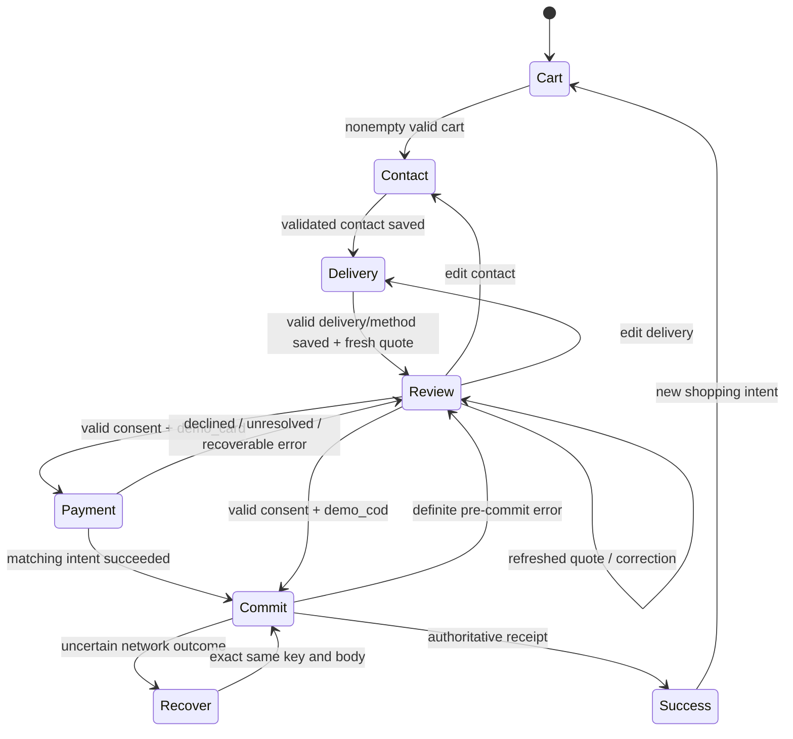

# MiBolt MVP — architecture specification

Status: implementation-ready design, not an implemented or tested Angular application. The exact contract and task acceptance criteria travel with this file.

## 1. Chosen approach and alternatives

**Chosen:** one feature-oriented Angular 22 SPA, small signal facades, generated HTTP SDK and one stateful MSW domain implementation. This preserves a future real-backend boundary while remaining backendless. It is easier to trace and test than mixing HTTP behavior into components.

Rejected for this MVP: a full NgRx entity/effects architecture (extra framework and duplicate abstraction for a small catalogue/cart wizard); a component-local fixture app (cannot demonstrate backend-like validation or SDK/contract parity); operator-specific microfrontends or Web Components design-system cloning (unproven need, greater scope). RxJS is retained only where cancellation/sequencing of generated Observable HTTP calls is useful; signals remain the public UI state.

## 2. Fixed scope

One fictional MiBolt provider and 16 fictional device products. One-time prices only in whole HUF. No subscriptions, monthly plans, installments, insurance, login, user profiles, real checkout provider, email, account verification, admin UI, product comparison, CMS, localization framework, analytics/social, chat or provider switcher. The supplied research describes operators, but does not authorize their assets, data or proprietary software. Optional O01 adds one licensed/local 3D model only after approval.

Four commerce page families: home, product catalogue, product details, purchase flow. The purchase family owns cart, contact, delivery/payment method, final review and confirmed demo receipt; these are routeable states, not additional unrelated visual systems.

## 3. Version and build policy

Verified planning baseline on 2026-09-14: Angular 22.1.6 is the latest stable in the official release list; 22.2.0-next builds are not stable. Recheck at T00 and pin the highest stable 22.x. Do not install a newer major by using unqualified `@latest`. [S01]

Angular 22 stabilized Signal Forms. Use `@angular/forms/signals` rather than treating Angular 21's experimental status as current. Explicitly use standalone components, signal APIs and built-in control flow. [S03–S06]

The published compatibility table currently lists the 22.0 family with Node ^22.22.3 || ^24.15.0 || ^26.0.0, TypeScript >=6.0.0 <6.1.0, and RxJS ^6.5.3 || ^7.4.0. Select Node 24 LTS in that supported range and verify the actual pinned 22.1.x compiler/package peers before installation; do not infer missing minor-version peer metadata from a table row. The toolchain-lock file records the resolved exact patch versions. [S02]

Use official Angular CLI application/unit-test builders, strict TS/strictTemplates, no Angular Material visual theme, SCSS/CSS semantic tokens, Angular CDK accessibility/dialog utilities where needed. `ng-openapi-gen` baseline 1.0.5 supports OpenAPI 3.1 and generated standalone API consumption. Explicit `promises:false` retains cancellation-friendly Observable calls. Do not confuse it with a different package called ng-openapi. [S07]

## 4. Dependency direction

```text
User / browser navigation
  ↓ signal input / DOM event
Page container (route-scoped composition)
  ↓ explicit facade method
Feature facade (private writable signals, readonly computed view model)
  ↓ generated Api.invoke(operation, typed params)
Angular HttpClient + API-root/session interceptors
  ↓ same-origin /api/v1 HTTP boundary
MSW handler → schema validation → mock domain → repository
  ↑ typed DTO / Problem
Facade → immutable signal update → page → presentational child inputs
```

No component imports mocks, fixtures, repository, API `HttpClient` directly or another feature's mutable signals. The only exception to ordinary one-way input/output composition is Signal Forms' field binding, where the form model owner is explicit. Shared presentational UI cannot inject a business facade.

## 5. State owners and lifetimes

| Owner | Lifetime | Source of truth | Exposed reads | Commands |
|---|---|---|---|---|
| AppConfigFacade | root | getConfig response | config/status | load, retry |
| CatalogFacade | catalogue route | canonical Router query + listProducts response | query, vm, resultCount | setSearch, setFilters, setSort, setPage, retry |
| ProductFacade | product route | getProduct + exact variant query | selectedVariant, gallery, vm | selectVariant, selectImage, retry |
| CartFacade | root | current mock Cart DTO | cart, itemCount, subtotal, pending, error | ensureCart, addItem, setQuantity, removeItem, refresh |
| CheckoutFacade | /penztar parent | volatile Signal Form model + checkout API draft + Quote | currentStep, canContinue, quote, submitState | saveContact, saveDelivery, refreshQuote, submit, retryUnknownOutcome |
| Dialog/Menu | local component/service | opened flag/trigger reference | opened | open, close |
| MockRepository | each demo tab/test context | domain catalogue/cart/draft/intents/orders/idempotency maps | handlers only | atomic mutation, reset, snapshot |

Derived totals displayed in purchase screens come from the returned Cart/Quote/OrderReceipt; UI may compute quantity sum for presentation only if tested against authoritative DTO. Do not maintain two independently writable totals. DTOs are readonly inputs to views; facades own immutable replacements.

## 6. Communication contracts

`CatalogQuery` contains `q`, unique `brands`, unique `storageGb`, optional minPrice/maxPrice, inStock/is5g, sort, page and pageSize. Router query names on the wire are singular `brand` and repeated `storageGb`. URI codec sorts repeated values, trims q, removes empty/default filters and uses page=1 after any filter/sort change. Unknown browser query values are cleaned with explanation where meaningful; direct invalid HTTP query returns 400. Page out of range gets the final valid page once; zero total stays page=1.

`AsyncState<T>` is a tagged union: `{status:'idle'|'loading'}`, `{status:'success',data:T,refreshing:boolean}`, `{status:'empty',data:T}`, `{status:'error',problem:UiProblem,previous?:T}`. A network error is never recoded as `[]`. Error state may preserve the previous rendered list with an explicit warning and disabled unsafe actions.

`CatalogFacade.setFilters(next: CatalogFilters): void` changes Router query, not an unrelated BehaviorSubject. `ProductFacade.selectVariant(id: string): void` updates the exact variant query and resets invalid gallery index. `CartFacade.addItem(command: {variantId:string;quantity:number}): void` enqueues a serialized write and owns its single managed subscription. A private Observable pipeline performs the SDK request; page event handlers invoke the void command, never subscribe to a second cold request. `CheckoutFacade.submit(): void` exhausts a concurrent second click and advances the state machine only on authoritative responses.

Read requests use switchMap to cancel obsolete HTTP and prevent late results. Cart writes are serialized with concatMap and take expected version when dispatched. Order submission uses exhaust semantics: never switchMap a transactional write. Every subscription is bounded by completion or takeUntilDestroyed. Effects are limited to genuine side effects such as title/focus/persistence; computed values are not propagated with cascading effects. [S05,S06]

## 7. Suggested source structure

```text
# docs/design/yettel.md is the design reference; no duplicate design-skill folder in docs
docs/api/openapi.yaml                single wire contract
docs/api/fixtures/                   deterministic synthetic data
src/main.ts                     bootstrap entry, fatal fallback
src/core/bootstrap-demo.ts      await mock hydrate/start, then Angular
src/styles/tokens.css           copied/generated semantic tokens
src/app/app.ts                  root outlet, global announcements
src/app/app.config.ts           locale/router/http/config providers
src/app/app.routes.ts           lazy page/layout boundaries
src/app/api/generated/          ng-openapi-gen output, no manual edits
src/app/core/api/               API root and demo-session interceptor
src/app/core/navigation/        header, footer, mobile drawer, cart count
src/app/layouts/                MarketingLayout, ShopLayout, CheckoutLayout
src/app/shared/ui/              primitives only, no business injection
src/app/shared/shell/           Header, Footer, DemoNotice, Menu
src/app/features/home/          hero, featured products, explainer
src/app/features/catalog/       URL codec, facade, filters and catalogue
src/app/features/product/       facade, variant matrix, gallery, specs
src/app/features/cart/          root facade, serialized queue, lines/summary
src/app/features/checkout/      parent facade, forms, guards, steps, submit
src/mocks/                     shared handlers/domain/repository/scenarios
public/mockServiceWorker.js    generated by MSW tooling
public/assets/products/        authorized local images only
public/assets/models/          absent until O01 approved
 tests/                         Node/Angular unit and SDK-contract tests
 scripts/                       generation, parity, policy and release gates
```

Tests live beside feature units where useful; top-level tests owns shared/contract fixtures. Do not create a monorepo or split repository unless there is a real second application. All production runtime code remains feature-local and participates in the explicit coverage manifest.

## 8. MSW repository and persistence

`createHandlers({repository,clock,ids,scenario,apiRoot})` returns the same handlers for browser setupWorker and Node setupServer. Handlers are thin: parse/validate, call domain, format response. MSW browser handlers run on the page side; the MSW service worker is an interception bridge, not a persistent backend database. Never assume its memory survives page reload. Await start before bootstrap to avoid startup races. [S08–S10]

Use a minimal dependency-free sessionStorage snapshot adapter for tab-scoped demo persistence, behind a typed interface. Memory implementation serves tests and storage-denied mode. Snapshot allowlist: schemaVersion, providerId, simulatedSessionId, savedAt/expiresAt, cart identity/items/version, simulated inventory, privacy-minimized receipts, safe order intent references/key digests and terminal order replay result. Never serialize contact, address, full checkout draft, raw request bodies or arbitrary registry maps.

Cart TTL and committed-order idempotency retention: 24 mock-clock hours. Quote TTL: 5 minutes. Any stale/schema-invalid persisted snapshot is discarded with a user-visible recovery. Before ordinary full reload, contact/address remain volatile by design: the cart restores, earliest incomplete checkout step reopens and explains the reset. Within one SPA session an HTTP/validation failure preserves all typed fields. Storage denied still supports a complete in-memory demo but explicitly warns that reload cannot restore it.

X-Demo-Session is an opaque namespace, NOT security. Distinct browser contexts have separate sessionStorage and repositories. A duplicated browser tab may copy sessionStorage; each page still uses isolated mock memory. True multi-tab concurrent commerce, authentication and server trust are outside scope; do not market session IDs as an authorization scheme.

## 9. Cart, quote, payment, order invariants

All prices originate from fixture catalogue values, not incoming requests. Money.amount is **whole HUF**, not ISO minor units. Avoid decimal multiplication. Item quantity 1..5 and <= available stock; reject rather than clamp. Same variant merges into one cart line. A successful cart mutation increments its version once and invalidates quote and intent. Draft updates invalidate quote/intent without changing cart version; UI serializes draft writes.

For mutations use `If-Match: "<cart.version>"` and `Idempotency-Key`. Idempotency lookup happens before comparing current cart status/version: a replay after success must not become a conflict. Scope key to session+method+path and canonical request fingerprint, including semantically relevant version precondition. A retry sends the identical body/precondition. Reusing a key with a different payload returns 409. Store terminal success or domain-conflict outcome for replay; transport errors before execution have no commit; failed schema validation mutates nothing. A PRICE_CHANGED quote response may atomically update cart/version and stores that conflict outcome so a retry cannot update it again.

Quotes do NOT reserve stock. Commit rechecks current inventory atomically. Price changes refresh authoritative cart and require explicit review. Quote cannot be used after an earlier step changes or 5 minutes pass. Card simulation accepts no card fields: createPaymentIntent is a same-origin MSW request, with deterministic succeeded/declined/pending status. Pending GET polling: 1s interval, maximum 10 attempts; surface unknown outcome on timeout.

For order commit: revalidate quote/session/cart/stock, require current demo terms+simulation acknowledgement, require matching succeeded intent only for demo_card, persist receipt and idempotency result, mark cart ordered, decrement stock exactly once, then clear volatile PII. Full rollback on conflict; never a partially stored receipt. A timeout-after-commit retries the same key/body. Successful replay uses persisted receipt before examining cleared volatile draft. Recovery without an actual commit returns to data entry because personal fields were intentionally not persisted.

## 10. Checkout transition model



No route guard performs mutation. Direct invalid step access goes to earliest valid prerequisite. Success route always reads getOrder and never repeats POST. Browser Back after success cannot resubmit an ordered cart.

## 11. Static deployment and maintenance

Same-origin logical API defaults /api/v1 but runtime root is resolved under the deployment base. Both SDK and MSW use the same resolved base. Media paths from contract are logical /assets paths and resolve under base; never naively prepend the current route. Worker script scope must contain all app routes and API calls. HTTPS/localhost is required for browser MSW, unlike the delivered offline design prototype.

Serve SPA fallback for app routes only; /api/v1 fails without MSW rather than returning HTML. index and mock worker use no-cache; hashed chunks use immutable caching. Do not register Angular PWA/service-worker caching. Unregister only the known obsolete MiBolt worker at its known scope when needed; never clear unrelated origin workers. Business actions are blocked on mock-start failure, not routed to a real service.

Budget targets (project decisions, not current measurements): initial JS 300 KiB gzip, lazy route 150 KiB gzip, initial-view transfer 1 MiB excluding optional 3D, CLS <=0.1. Test at a recorded desktop and narrow emulated profile. Accessibility and resource audits require an optimized build separate from an instrumentation build.

## 18. Supplied local device art and asset URL boundary

The plan supplies original fictional front/back artwork in `docs/design/assets/products`, with `docs/design/asset-manifest.json` provenance. Copy the WebP files to `public/assets/products/` in T10. These files do not claim real-device fidelity or contain functional UI text. All fixture media references resolve to an included image; matching casing color and view are explicit.

ProductImage uses `resolveAssetUrl(path: string, documentBaseUri: string): string` from `src/app/shared/media/resolve-asset-url.ts`. It accepts the two shapes the API contract allows for `Image.src` (`docs/api/openapi.yaml`, `Image`): a root-relative path such as `/api/v1/media/<id>` or `/assets/products/<file>`, stripped of its leading slash and resolved under `document.baseURI` with any result outside the same-origin base rejected, and an absolute `http(s)` URL (a content delivery network) passed through unchanged. A `..` or `.` segment, encoded traversal, a protocol-relative `//host`, a relative path and every other scheme (`javascript:`, `data:`, `ftp:`) are rejected. Test the `/` deployment, an absolute URL and malformed paths. Every `` the application renders goes through this function.
