# Feladatok és függőségek

A **T00–T29** feladatok kötelezőek. Az **O01** csak külön jóváhagyott 3D-bővítés: alapértelmezésben nem kell megvalósítani, és nem blokkolja az alap MVP-t.

A végrehajtási rendet a [végrehajtási szabályok](../spec/execution-rules.md) rögzítik. Minden feladathoz külön megvalósító subagent, független specifikáció-review, független kód-/tesztreview és szükség szerint valódi böngészős ellenőrzés tartozik. A design skill mindegyik szerepkörnél és minden javítás utáni újraellenőrzésnél kötelező.

A géppel olvasható [tasks.json](tasks.json) és a feladatlapok ugyanazokat az azonosítókat, függőségeket és elfogadási feltételeket tartalmazzák. A [requirements.json](requirements.json), a [project-acceptance.json](project-acceptance.json) és a [test-scenarios.json](test-scenarios.json) az automatikus megfelelőség-ellenőrzés bemenetei; nem korábbi tesztfutás eredményei.

A csomag `PLANNED` értékeit ne tekintsd kész állapotnak. A tényleges végrehajtási státuszt a létrehozandó `docs/mi-bolt/execution/progress.json` vezesse. Feladat csak minden előfeltétel **ACCEPTED** állapota után indítható.

## Feladatjegyzék

| Feladat | Tartalom | Előfeltétel |
|---|---|---|
| [T00](T00.md) | Követelmények, verziózár és kötelező design-governance | nincs |
| [T01](T01.md) | Angular 22 SPA és munkaterület | T00 |
| [T02](T02.md) | 100% coverage és hálózati izoláció bizonyító teszt | T01 |
| [T03](T03.md) | OpenAPI 3.1 szerződés és fixture-k | T00 |
| [T04](T04.md) | ng-openapi-gen SDK és adat-hozzáférés | T01, T03 |
| [T05](T05.md) | MSW indítás, repository és forgatókönyvek | T02, T03, T04 |
| [T06](T06.md) | Katalógus mock és szűrési szemantika | T05 |
| [T07](T07.md) | Állapottartó kosár mock | T05 |
| [T08](T08.md) | Checkout draft, szállítás és árajánlat mock | T07 |
| [T09](T09.md) | Szimulált fizetés és idempotens rendelés mock | T08 |
| [T10](T10.md) | Design tokenek és UI-alapelemek | T01, T02 |
| [T11](T11.md) | Három layout, navigáció és globális állapot | T05, T10 |
| [T12](T12.md) | Katalógus URL-state és signal facade | T04, T06, T11 |
| [T13](T13.md) | Terméklista képernyő | T10, T12 |
| [T14](T14.md) | Főoldal | T11, T12 |
| [T15](T15.md) | Termék- és változatkezelő facade | T04, T06 |
| [T16](T16.md) | Termékoldal és képgaléria | T10, T11, T15 |
| [T17](T17.md) | Globális kosár signal facade | T04, T07 |
| [T18](T18.md) | Kosár képernyő és kosárba helyezés | T11, T16, T17 |
| [T19](T19.md) | Checkout scope, Signal Forms és route guardok | T08, T18 |
| [T20](T20.md) | Kapcsolattartási adatok képernyőállapot | T10, T19 |
| [T21](T21.md) | Szállítás és fizetési mód állapot | T08, T20 |
| [T22](T22.md) | Végső ellenőrzés és árváltozás | T19, T21 |
| [T23](T23.md) | Rendelésvezérlés, retry és függő fizetés | T09, T22 |
| [T24](T24.md) | Sikeroldal, visszatöltés és lezárás | T11, T23 |
| [T25](T25.md) | Reszponzív, állapot- és akadálymentességi audit | T13, T14, T16, T18, T20, T21, T22, T24 |
| [T26](T26.md) | SDK–MSW szerződésparitás | T04, T06, T07, T08, T09 |
| [T27](T27.md) | Teljes unit és E2E lefedettség lezárása | T02, T25, T26 |
| [T28](T28.md) | Statikus kiadás, teljesítmény és SW-életciklus | T24, T25, T27 |
| [T29](T29.md) | Végső elfogadás és átadás | T27, T28 |
| [O01](O01.md) | Opcionális 3D terméknézet – csak jóváhagyás után | T02, T16 |

## Dependency gráf

```mermaid
flowchart LR
  T00["T00 · Követelmények, verziózár és kötelező design-governance"]
  T01["T01 · Angular 22 SPA és munkaterület"]
  T00 --> T01
  T02["T02 · 100% coverage és hálózati izoláció bizonyító teszt"]
  T01 --> T02
  T03["T03 · OpenAPI 3.1 szerződés és fixture-k"]
  T00 --> T03
  T04["T04 · ng-openapi-gen SDK és adat-hozzáférés"]
  T01 --> T04
  T03 --> T04
  T05["T05 · MSW indítás, repository és forgatókönyvek"]
  T02 --> T05
  T03 --> T05
  T04 --> T05
  T06["T06 · Katalógus mock és szűrési szemantika"]
  T05 --> T06
  T07["T07 · Állapottartó kosár mock"]
  T05 --> T07
  T08["T08 · Checkout draft, szállítás és árajánlat mock"]
  T07 --> T08
  T09["T09 · Szimulált fizetés és idempotens rendelés mock"]
  T08 --> T09
  T10["T10 · Design tokenek és UI-alapelemek"]
  T01 --> T10
  T02 --> T10
  T11["T11 · Három layout, navigáció és globális állapot"]
  T05 --> T11
  T10 --> T11
  T12["T12 · Katalógus URL-state és signal facade"]
  T04 --> T12
  T06 --> T12
  T11 --> T12
  T13["T13 · Terméklista képernyő"]
  T10 --> T13
  T12 --> T13
  T14["T14 · Főoldal"]
  T11 --> T14
  T12 --> T14
  T15["T15 · Termék- és változatkezelő facade"]
  T04 --> T15
  T06 --> T15
  T16["T16 · Termékoldal és képgaléria"]
  T10 --> T16
  T11 --> T16
  T15 --> T16
  T17["T17 · Globális kosár signal facade"]
  T04 --> T17
  T07 --> T17
  T18["T18 · Kosár képernyő és kosárba helyezés"]
  T11 --> T18
  T16 --> T18
  T17 --> T18
  T19["T19 · Checkout scope, Signal Forms és route guardok"]
  T08 --> T19
  T18 --> T19
  T20["T20 · Kapcsolattartási adatok képernyőállapot"]
  T10 --> T20
  T19 --> T20
  T21["T21 · Szállítás és fizetési mód állapot"]
  T08 --> T21
  T20 --> T21
  T22["T22 · Végső ellenőrzés és árváltozás"]
  T19 --> T22
  T21 --> T22
  T23["T23 · Rendelésvezérlés, retry és függő fizetés"]
  T09 --> T23
  T22 --> T23
  T24["T24 · Sikeroldal, visszatöltés és lezárás"]
  T11 --> T24
  T23 --> T24
  T25["T25 · Reszponzív, állapot- és akadálymentességi audit"]
  T13 --> T25
  T14 --> T25
  T16 --> T25
  T18 --> T25
  T20 --> T25
  T21 --> T25
  T22 --> T25
  T24 --> T25
  T26["T26 · SDK–MSW szerződésparitás"]
  T04 --> T26
  T06 --> T26
  T07 --> T26
  T08 --> T26
  T09 --> T26
  T27["T27 · Teljes unit és E2E lefedettség lezárása"]
  T02 --> T27
  T25 --> T27
  T26 --> T27
  T28["T28 · Statikus kiadás, teljesítmény és SW-életciklus"]
  T24 --> T28
  T25 --> T28
  T27 --> T28
  T29["T29 · Végső elfogadás és átadás"]
  T27 --> T29
  T28 --> T29
  O01["O01 · Opcionális 3D terméknézet – csak jóváhagyás után"]
  T02 --> O01
  T16 --> O01
  O01 -. "only when approved" .-> T29
```

A gráf interaktívan is megnyitható az [áttekintő riportban](../index.html#tasks). A topológiai hullám nem időbecslés és önmagában nem engedély párhuzamos fájlmódosításra. Közös fájl vagy még nem rögzített interfész esetén soros integráció szükséges.
